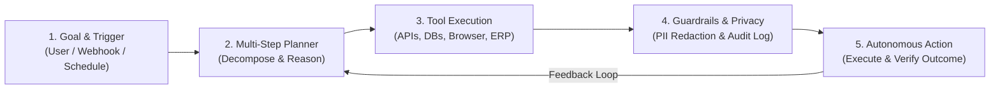

# Dubai Chamber: Create AI Agents Championship — Strategy & Ideation Guide

> [!IMPORTANT]
> **Huge Strategic Advantage for Your Group (`FY I MTech`):**
> Because you are in **First Year Integrated MTech**, if your team lead is **under 21 years old at the time of registration**, you qualify for **Category 4: Best Youth AI Agent – Top Youth-Led Venture** (`\$150,000` grant) **AND** can submit additional entries in the Business, Societal, or Personal categories (the rules explicitly allow submitting more than one application!).

---

## 1. Official Competition Snapshot & Judging DNA

| Feature | Official Details (`dubaichamberdigital.com`) |
| :--- | :--- |
| **Prize Pool** | **USD 750,000 total** — **USD 150,000 grant** for each of the 4 category winners + additional grand funding for **Dubai AI Agent of the Year**. |
| **Eligibility** | Open **globally** (international students, builders, and startups expanding to Dubai/UAE). Free entry. |
| **Team Size** | Individual or teams up to **6 members** (each member registers individually on the platform during Oct–Dec 2026). |
| **Multiple Entries** | **Allowed** — you register once as a participant and can submit multiple AI Agent applications in Nov 2026 – Jan 2027. |
| **Deliverables (Jan 2027)** | Working **AI-Agent Prototype**, **Pitch Deck**, and **Demo Video** (in English). |
| **Grand Final (May 2027)** | Top 24 enter the **Tech Accelerator Programme** (Jan 2027) → Top 12 pitch a **fully functional live AI Agent** on stage in Dubai. |

### What Separates a Winning "AI Agent" from a Disqualified "Chatbot"?
The official FAQ explicitly warns: *"An AI agent is more than a chatbot. Unlike traditional AI, which usually responds to a single prompt, an AI agent can **understand a goal, plan multiple steps, use tools, connect with other systems, learn from results, and take action** towards an outcome."*

> [!CAUTION]
> **Mandatory Rule Check:** Every submission is evaluated on **data protection and preventing information leakage**. Including an explicit **Privacy & Governance Guardrail Layer** (PII masking, role-based tool permissions, audit trail) in our prototype will immediately set your submission apart from 90% of competitors.

---

## 2. Comparison of the 4 Award Categories

| Category | Grant | Target Users & Buyer | Competition Level | Best Fit Strategy for Your Team |
| :--- | :--- | :--- | :--- | :--- |
| **01. Best Societal AI Agent** | `\$150,000` | Communities, public health, sustainability, accessibility, civic services | **Medium** | **High Win Probability if tied to UAE priorities** (Net Zero 2050, blue-collar worker welfare, accessibility, crisis response). Judges love measurable social ROI. |
| **02. Best Personal AI Agent** | `\$150,000` | Everyday consumers (health, wellbeing, personal finance, productivity) | **Very High** | **Hardest to differentiate** unless it goes beyond generic calendar/to-do assistants and solves a deep, high-stakes personal pain point (e.g., expat life admin, chronic health navigation). |
| **03. Best Business AI Agent** | `\$150,000` | SMEs, enterprises, government agencies, logistics, trade, real estate | **High (Experienced Startups)** | **Strongest alignment with Dubai Chamber of Digital Economy's core mission (D33 Agenda)**. Winners here show clear B2B revenue, hours/money saved, and live ERP/CRM/WhatsApp tool execution. |
| **04. Best Youth AI Agent (Top Youth-Led Venture)** | `\$150,000` | Any of the above (Societal, Personal, or Business), led by a founder **under 21** | **Lowest (Age-Gated)** | **#1 Recommended Primary Entry** if your lead applicant is under 21. You compete only against other under-21 teams while still being eligible for **Dubai AI Agent of the Year**! |

### Recommended Dual-Submission Strategy
Since the championship allows **multiple submissions**, your sharpest strategy is:
1. **Entry A (Youth Category):** Submit your strongest venture-scale AI Agent with an under-21 team lead.
2. **Entry B (Business or Societal Category):** Submit a second specialized AI Agent (or a distinct vertical solution) into **Best Business AI Agent** or **Best Societal AI Agent**.

---

## 3. Eight Winning AI Agent Ideas (Tailored for Dubai & Global Scale)

### Category 1: Best Business AI Agent (B2B & Public Sector)

#### Idea 1: ** clearsync.ai — Autonomous Cross-Border Trade & Customs Compliance Agent**
* **The Problem:** Dubai is a global trade hub connecting India, Asia, Europe, and GCC. SMEs lose thousands of dollars and days of delay due to mismatched HS codes, Bill of Lading discrepancies, Certificates of Origin, and changing customs regulations across ports (Jebel Ali, Mumbai, Mundra).
* **How the Agent Works (Multi-Step & Tool Use):**
  1. **Ingests** commercial invoices, packing lists, and bills of lading via email/WhatsApp/upload.
  2. **Cross-verifies** item descriptions against live GCC & international HS tariff databases and sanctions/restricted-goods lists.
  3. **Detects discrepancies** (weight mismatch, missing Halal/standards certificates) and **autonomously drafts & sends** correction requests to suppliers via WhatsApp/Email.
  4. **Pre-fills** customs declaration payloads (Dubai Trade / Mirsal 2 format) with a zero-leakage PII vault.
* **Business Model:** SaaS subscription (`\$199/mo`) + per-shipment autonomous clearance fee (`\$5/shipment`) for freight forwarders and import/export SMEs.

#### Idea 2: ** procureOps — WhatsApp-Native Autonomous Vendor & Procurement Agent for SMEs**
* **The Problem:** In the UAE and India, 80% of SME procurement (restaurants, construction, retail) happens over fragmented WhatsApp chats, voice notes, and PDF quotes in English, Arabic, and Hindi. Owners overpay by 15–20% and run out of stock.
* **How the Agent Works:**
  1. **Monitors** inventory thresholds from POS/ERP.
  2. **Autonomously messages** 5 approved suppliers to request quotes, parses PDF/voice-note replies in English/Arabic/Hindi, and **negotiates** bulk discounts or delivery SLAs within pre-set budget guardrails.
  3. **Generates** a purchase order, routes a 1-tap approval card to the business owner, and schedules delivery tracking.
* **Business Model:** Monthly SaaS tier + % of negotiated savings.

---

### Category 2: Best Societal AI Agent (Community & Sustainability)

#### Idea 3: ** heatShield / KaramaCare — Multilingual Migrant Worker Health, Safety & Rights Agent**
* **The Problem:** Millions of blue-collar and gig workers in the GCC and South Asia speak Hindi, Marathi, Urdu, Malayalam, Tagalog, or Bengali, and struggle to navigate heat-stress safety alerts, insurance claims, tele-triage, and wage/contract protections.
* **How the Agent Works:**
  1. **Voice-first WhatsApp Agent** that understands regional dialects.
  2. **Takes autonomous action:** Books nearby clinic appointments covered by their exact insurance card (via OCR), files workplace safety or heat-index alerts with site supervisors, and translates official labor/municipality documents into voice explanations.
  3. **Proactive Environmental Trigger:** Connects to live weather/WBGT heat-stress APIs to autonomously schedule hydration breaks and alert site managers.
* **Business Model:** B2G / B2B CSR & compliance licensing for construction, logistics, and delivery fleet companies (helping them meet UAE ESG and worker-welfare mandates).

#### Idea 4: ** gridPulse — Autonomous Building Energy & Water Micro-Optimization Agent (UAE Net Zero 2050)**
* **The Problem:** Commercial towers, universities, and hotels in hot climates waste 25–35% of cooling (HVAC) and water due to static schedules that ignore real-time occupancy, solar load, and dynamic utility tariffs (DEWA Peak Load).
* **How the Agent Works:**
  1. **Connects** to IoT smart meters, weather forecasts, and building room-booking calendars.
  2. **Plans & executes** pre-cooling cycles before peak tariff hours, adjusts zone setpoints in unoccupied wings, and isolates suspected water leaks by triggering smart valves and dispatching maintenance tickets with exact anomaly diagnostics.
* **Business Model:** Performance-based SaaS (shared percentage of verified electricity/water bill savings).

---

### Category 3: Best Personal AI Agent (Everyday Life & Productivity)

#### Idea 5: ** RelocateOS — Autonomous Expat & Golden Visa Life-Admin Agent**
* **The Problem:** Moving to or living in a global hub like Dubai (or relocating internationally) requires chaining 15+ interdependent steps: visa medicals, Emirates ID, tenancy contract (Ejari), utility connection (DEWA), telecom, school enrollment, and license conversion. Missing one document stalls everything.
* **How the Agent Works:**
  1. **Builds a live dependency graph** of the user's life-admin goal.
  2. **Validates documents** (passport validity, attestation stamps, photo specs), **monitors appointment slots**, books medical/typing center slots, pre-fills forms, and tracks expiry renewals years in advance.
  3. **Zero-Leakage Personal Vault:** Processes sensitive IDs locally/ephemerally with strict cryptographic redaction.
* **Business Model:** B2C freemium (`\$29` relocation pass) + B2BHR employee-onboarding packages for companies hiring international talent.

#### Idea 6: ** CareLoop — Autonomous Chronic Care & Polypharmacy Family Agent**
* **The Problem:** Managing a parent's or patient's diabetes/hypertension involves lab PDFs, conflicting prescriptions from multiple doctors, insurance pre-approvals, and pharmacy refills.
* **How the Agent Works:**
  1. **Reads** lab reports and discharge summaries, checks drug-drug interactions via clinical databases (OpenFDA / RxNorm), and flags risks.
  2. **Autonomously coordinates** prescription refills with pharmacies, submits insurance pre-authorization packets, and schedules follow-up lab tests around the patient's calendar.
* **Business Model:** Subscription for family caregivers + partnerships with insurers and diagnostic chains.

---

### Category 4: Best Youth AI Agent – Top Youth-Led Venture (Under 21 Lead)

#### Idea 7: ** SkillForge AI — Autonomous Proof-of-Work & Micro-Internship Agent for Students**
* **The Problem:** Students graduate with degrees but struggle to prove real-world engineering/business capability, while startups have backlogs of small tasks (QA, data cleaning, UI fixes, market research) they don't have time to scope.
* **How the Agent Works:**
  1. **Connects** to a startup's GitHub/Jira/Notion, autonomously scopes small backlog issues into verified 48-hour micro-bounties with automated test suites.
  2. **Matches** student builders based on verified skill graphs, acts as an AI pair-mentor with strict IP/data-leakage sandboxing, grades the submission via automated tests, and issues verifiable credentials/payouts.
* **Business Model:** Marketplace take-rate (15% on micro-bounties) + enterprise hiring pipeline subscriptions.

#### Idea 8: ** FinGuard Youth / Solopreneur — Autonomous Invoice, Tax & Cashflow Recovery Agent**
* **The Problem:** Young founders, freelancers, and micro-agencies lose 30% of their time chasing late invoices, reconciling bank statements, and navigating UAE Corporate Tax / GST compliance.
* **How the Agent Works:**
  1. **Detects** completed milestones in project tools, generates compliant invoices, and **autonomously follows up** on overdue payments via polite, context-aware email/WhatsApp escalations.
  2. **Categorizes** expenses, sets aside tax reserves automatically, and simulates 90-day cashflow runway.
* **Business Model:** `\$15/mo` SaaS for creators, freelancers, and student-led ventures.
