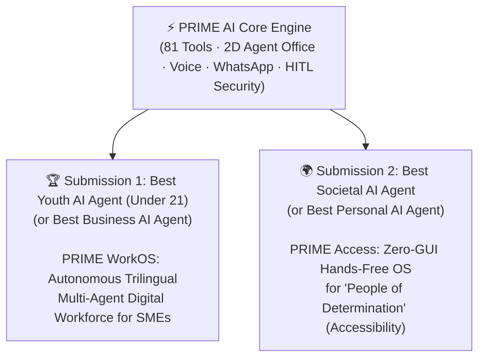

# Evaluation of `prime-II1` (PRIME AI) for the Dubai AI Agents Championship

## Verdict: **9.5 / 10 Technical Foundation — Potential Category Winner (`\$150,000` Grant)**

Most teams entering the **Create AI Agents Championship** will submit basic LangChain/OpenAI wrapper chatbots built in a weekend. **[`prime-II1`](https://github.com/thoratpratik2323-hue/prime-II1)** is already a **production-grade, 81-tool autonomous operating system** with **285+ passing unit tests across 22 suites**.

---

## 1. Why `prime-II1` Directly Hits Every Official Judging Criterion

| Dubai Chamber Criterion | What Judges Look For | What `prime-II1` Already Has Built |
| :--- | :--- | :--- |
| **"More Than a Chatbot"** | Multi-step planning, tool use, external system integration, autonomous action | **81 Native Tools**, **Stigmergy Mailbox Protocol (`core/dots_mailbox.py`)**, **8 Autonomous Agents**, **WhatsApp Voice/Video Calling & Scheduling**, **OS/Browser control** |
| **Data Protection & Zero Leakage** | *"Must protect personal, confidential and organizational data and prevent information leakage"* | **Zero-Eval AST Parsers** (`safe_code_executor.py`), **PowerShell & System Root Guardrails**, **Voice-First HITL Approval Gatekeeper**, **Offline Ollama/Faster-Whisper fallback** |
| **Live Stage Demo (May 2027)** | *"Finalists must present a fully functional, working AI Agent on stage — not an MVP"* | **Live 2D Virtual Office Floor (`localhost:8765/office`)** + **24/7 Zero-Gap Voice** + **Neural Mesh Mobile Bridge** + **Sub-0.4s Groq LPU Failover** (guarantees your live stage demo won't crash if Wi-Fi/Gemini lags!) |
| **Youth Venture Eligibility** | Lead applicant **under 21** at registration | Qualifies directly for **Best Youth AI Agent – Top Youth-Led Venture (`\$150,000`)** while remaining eligible for **Dubai AI Agent of the Year** |

---

## 2. The 3 Critical Gaps to Fix Before Submitting to Dubai Judges

While the engineering is elite, hackathon juries at **Dubai Chamber of Digital Economy** evaluate **50% on Technical Execution** and **50% on Commercial Viability & Regional Impact**. Here are the 3 traps to fix:

> [!WARNING]
> **Trap 1: "Built for One Developer" vs. "Scalable Venture"**
> Currently, the README states *"Engineered for Pratik Thorat"* and names the multi-agent suite **"Munder Difflin"** with TV characters (*Dwight, Jim, Pam, Michael, Creed*).
> * **The Fix:** Add a configurable **Enterprise Venture Mode** to the 2D Office Floor (`localhost:8765/office`) that re-labels the 8 agents as **Autonomous Enterprise Roles** (*Operations Lead, WhatsApp CRM Agent, Procurement Negotiator, FinOps Auditor, SecOps Sentinel, QA Engineer, Knowledge Indexer, Executive Scheduler*) so investors immediately see a **B2B SaaS product** SMEs will pay `\$99–\$299/month` for.

> [!IMPORTANT]
> **Trap 2: Adding UAE Arabic (`ar-AE`) to Your Bilingual Voice Engine**
> Your `voice_engine.py` already auto-detects English (`en-US-BrianMultilingualNeural`) and Hindi/Hinglish (`hi-IN-MadhurNeural`).
> * **The Fix:** Add **Emirati Arabic (`ar-AE-HamdanNeural` / `ar-AE-FatimaNeural`)** detection (`is_arabic()`) right alongside Hindi and English. In Dubai, **Arabic + English + Hindi** covers **95%+ of the entire government, business, and workforce population**! Demonstrating instant trilingual switching live on stage will win massive points with UAE judges.

> [!TIP]
> **Trap 3: Explicit PII Redaction & Compliance Dashboard**
> The rules specifically mandate preventing organizational information leakage.
> * **The Fix:** Add a visible **DLP (Data Loss Prevention) & PII Redaction Filter** before prompts leave for cloud LLMs (masking Emirates ID, IBAN, credit cards, phone numbers, and `.env` secrets, or auto-routing sensitive prompts to local Ollama) and show a live **"Privacy Shield Active"** counter on the `/office` dashboard.

---

## 3. Winning Dual-Submission Strategy Using `prime-II1`

Because the Championship explicitly allows **multiple submissions**, you can leverage `prime-II1` across **two distinct award categories** to double your odds of making the Top 24 Semi-Finals and winning `\$150,000`:

### Submission 1: **PRIME WorkOS** *(Target: Best Youth AI Agent / Best Business AI Agent)*
* **Value Proposition:** Small and medium businesses (SMEs) in Dubai and India can't afford a 10-person operations, IT, and customer support team. **PRIME WorkOS** gives any SME an autonomous 8-agent digital office (`localhost:8765/office`) that answers customer WhatsApp calls/messages, schedules follow-ups, audits documents/code, and executes desktop tasks via voice in **Arabic, English, and Hindi**.
* **Business Model:** `\$99/mo` Pro Workstation · `\$299/mo` SME Multi-Agent Swarm · Enterprise On-Premise License.

### Submission 2: **PRIME Access** *(Target: Best Societal AI Agent / Best Personal AI Agent)*
* **Value Proposition:** In the UAE, individuals with disabilities are officially honored as **People of Determination** under the National Policy for Empowering People of Determination. Yet millions of people with motor impairments, spinal injuries, RSI, or cerebral palsy cannot use a mouse and keyboard to work in tech. **PRIME Access** turns any Windows PC into a **100% Zero-GUI, Hands-Free Autonomous Workstation**—letting users write code, control browsers, manage files, and make WhatsApp calls purely by ambient voice and Voice-First HITL confirmation.
* **Business Model:** B2G (Government workforce inclusion programs) & Enterprise Accessibility Compliance seats (`\$29/seat/mo`), subsidizing free access for students with disabilities.

---

## 4. Proposed Action Plan in This Workspace (`Hackathons\UA`)

1. **Clone `prime-II1`** into `c:\Users\thora\Documents\My Work\Hackathons\UA\prime-uae-agent`.
2. **Build the Dubai Championship Upgrade Pack** (with full unit tests):
   - **Trilingual Voice Router (`ar-AE` + `en-US` + `hi-IN`)** in `voice_engine.py`.
   - **PII & UAE Data-Leakage Guardrail (`core/dlp_shield.py`)** redacting Emirates IDs, credit cards, API keys, and IBANs before cloud LLM calls.
   - **Enterprise / Dubai Edition Toggle** on the 2D Office Floor (`/office`) switching between Munder Difflin mode and **PRIME Enterprise / Accessibility Command Center**.
3. **Generate the Championship Submission Kit**:
   - Official Application Answers, 10-Slide Investor Pitch Deck, and 3-Minute Live Demo Script.
